# 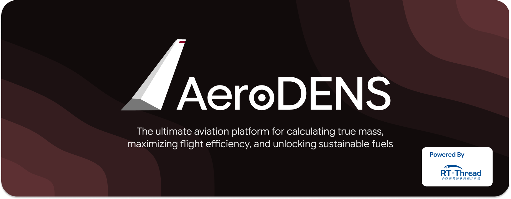

AeroDENS is a standalone embedded avionics advisory and flight telemetry system built for the GigaDevice GD32H759I-EVAL evaluation board. 

[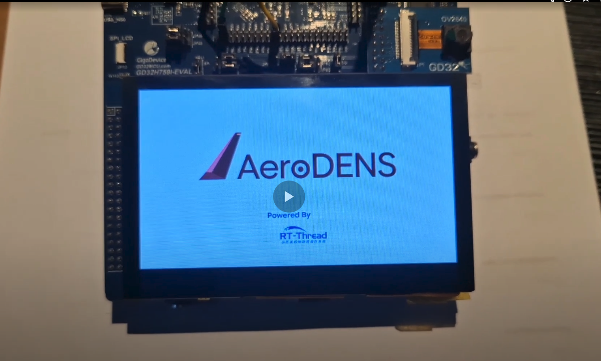](https://res.cloudinary.com/dezykjpfz/video/upload/v1793813990/startup_feature_alwagj.mp4
)

It runs on a 600 MHz ARM Cortex-M7 microcontroller, providing realtime fuel density correction for Sustainable Aviation Fuel (SAF) blends, dynamic weight and balance calculation, flight crew advisories, and persistent telemetry logging.

---

<br>
<br>


### The Problem
Commercial aviation relies on legacy Flight Management Systems (FMS) and Fuel Quantity Management Systems (FQMS) that are strictly calibrated to a standard atmospheric model, specifically assuming a fixed fuel density (approx. 0.803 kg/L for Jet A-1) at exactly 15°C.

In real world operations, extreme temperature fluctuations, from a 35°C hot tarmac to a -40°C cruise altitude, cause jet fuel to constantly expand and shrink in volume. Because aircraft fuel probes measure volume and the FMS multiplies this by a fixed, static density, the legacy computers frequently hallucinate what I call the term "Phantom Weight." When hot fuel expands, the FMS overestimates the True Gross Weight, creating a cascade of aerodynamic inefficiencies:

1. The aircraft calculates suboptimal altitude targets, forcing the plane to fly lower in thicker air due to imaginary weight corrections.

2. Cruise Mach numbers become inefficient, and the calculated Center of Gravity (% MAC) drifts from physical reality.

3. Pilots miss critical step climb opportunities, resulting in active fuel waste and unnecessary CO2 emissions.
 
Furthermore, as the aviation industry begins transitioning to Sustainable Aviation Fuel (SAF), which possesses a fundamentally lower base density (~0.759 kg/L), this strict FMS calibration flaw will compound, rendering legacy weight calculations increasingly inaccurate.

<br>

### The Solution
I built AeroDENS as a dedicated advisory system to bypass legacy FMS limitations directly in the cockpit. By ingesting realtime hardware in the loop telemetry (Outside Air Temperature, fuel temperature, tank volumes, altitude, and Mach speed), alongside the specific SAF blend ratio, AeroDENS calculates the true, temperature adjusted fuel density on the fly.

By actively identifying and shedding "Phantom Weight," AeroDENS establishes the precise True Gross Weight (TGW) and physical Center of Gravity. The embedded physics engine then translates this into closed loop advisories, giving pilots mathematically proven, actionable guidance for step climbs, trim speed adjustments, and crossfeed balancing. Once the pilot achieves the optimal aerodynamic profile, AeroDENS acts as a live monitoring system, proving the exact kilograms of fuel and CO2 saved.

---

<br>


- **Live SAF Density Correction**: Dynamically adjusts fuel density based on SAF blend percentage (0% to 100%) and outside air temperature variations.
- **True Weight and Balance Engine**: Converts indicated tank volumes into true fuel weight and recalculated gross weight, tracking Center of Gravity (% MAC) shift.
- **Visual Flight Dashboard**: Visualize Aircraft Stats (Airbus A320 and A330 supported configurations) such as live fuel distribution across left wing, center, and right wing tanks, co2 and fuel saved, etc.
- **In Flight Crew Advisories**: Generates realtime alerts for:
  - Step climb opportunities as gross weight decreases.
  - Optimal cruise Mach number and trim speed corrections.
  - Lateral fuel tank imbalance warnings.
  - Cumulative fuel saved (kg) and CO2 emissions prevented.
- **Flight Database & Route Setup**: Built in record of supported commercial airline flights (Cebu Pacific, Philippine Airlines, Thai Airways) with scheduled block times, route coordinates, and custom flight creation.
- **Background SD Card Logging**: Records full telemetry frames and advisory events to CSV format on MicroSD via SDIO FatFs for later auditing.

---

<br>


## Installation

AeroDENS can be installed in two ways:
1. **Flashing Pre built Firmware**: Quickest method using the flasher tool and `.tar` firmware file.
2. **Compiling from Source**: Full build from source code using PlatformIO.

---

### Part 1: Installation via Flashing

First, you have to obtain a valid AeroDENS device firmware. You can download the latest `.tar` firmware from the [releases](https://github.com/jian6137/aerodens-gd32h759i/releases) page.

Once downloaded, you can use the built in flasher tool in this repository. It is a python GUI and CLI tool, which can be set up with the guide below
#### Requirements Installation
The flasher requires Python 3.9 or newer and standard dependencies listed in `requirements.txt`:
```bash
pip install -r requirements.txt
```
*(If you only need the flasher standalone, you can also run `pip install -r tools/flasher/requirements.txt`)*

Note for Linux users: The flasher GUI runs on Python's built in Tkinter framework. If Tkinter is not bundled with your distribution's Python, install it via your system package manager:
- Ubuntu/Debian: `sudo apt-get install python3-tk`
- Fedora/RHEL: `sudo dnf install python3-tkinter`
- Arch Linux: `sudo pacman -S tk`

#### Using the Graphical Flasher
1. Connect your GD32H759I-EVAL board to your computer using the USB cable connected to the GD-Link / CMSIS-DAP port.

    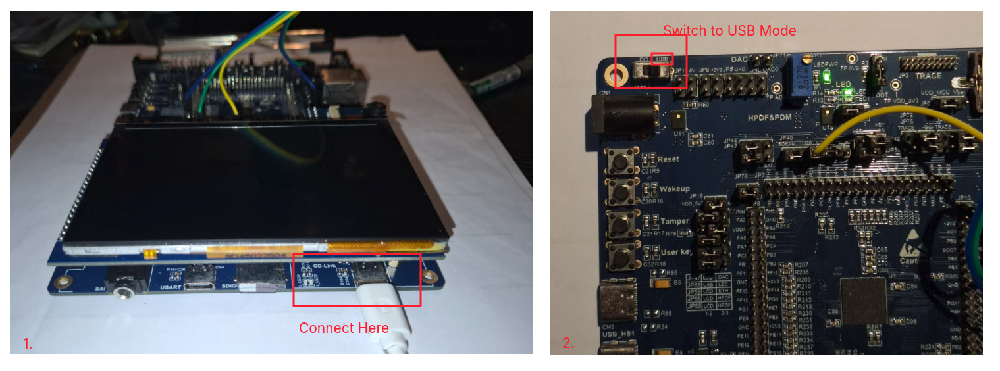

2. Launch the flasher application:
   ```bash
   python3 tools/flasher/flasher.py
   ```
3. Click the **CONNECT** button. The flasher queries USB devices for GigaDevice CMSIS-DAP debuggers and confirms the connection.

   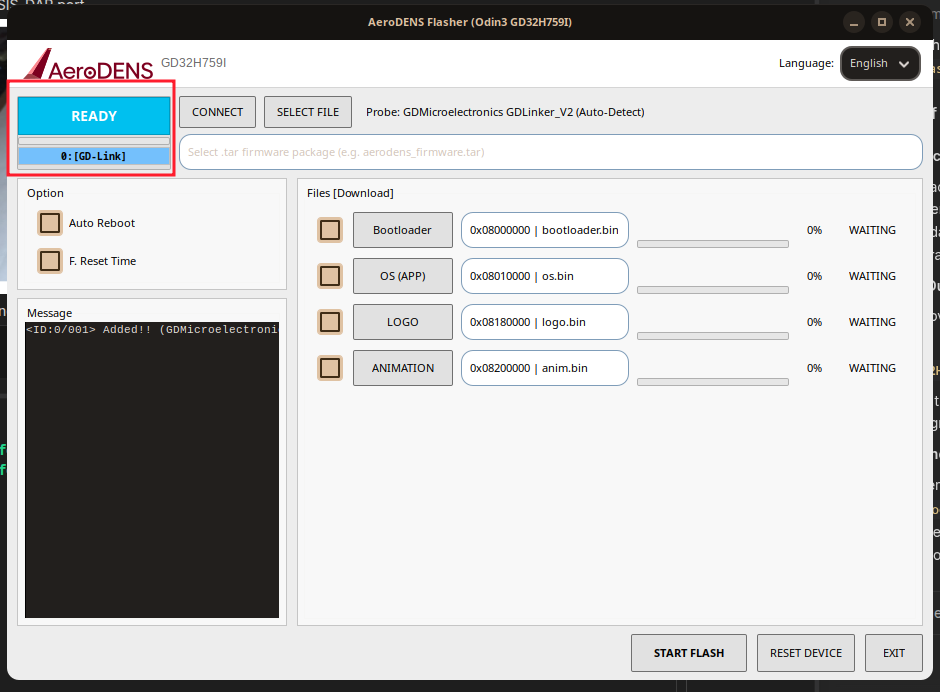

4. Click **SELECT FILE** and select your downloaded `.tar` firmware file.
   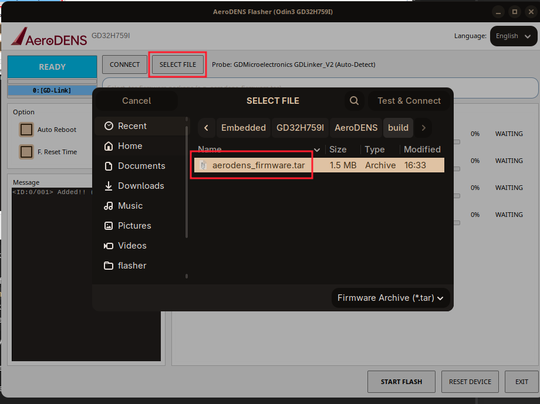
5. The flasher validates the tar firmware contents and will display `File analysis.. OK` in the message window once the selected firmware file has been validated.
6. Click **START**. The flasher erases, programs, and verifies each partition with individual progress bars.
   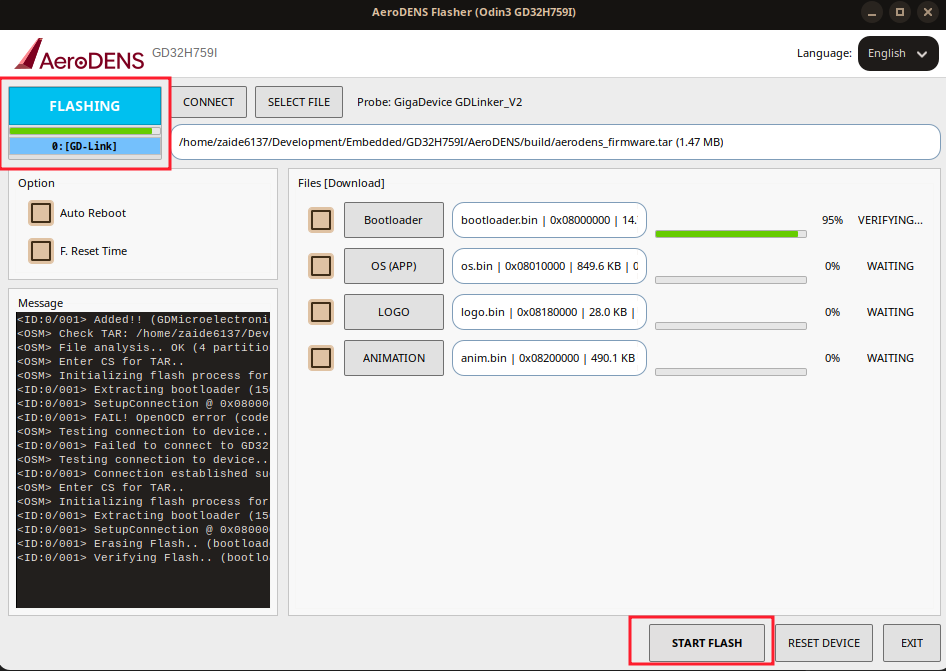
7. Once finished, a confirmation dialog appears, and the target microcontroller resets automatically.
   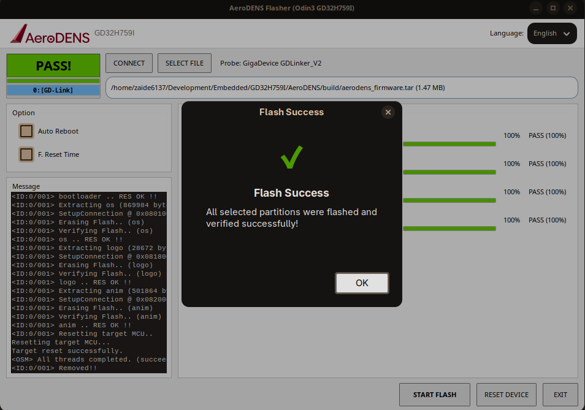

#### Using the Command-Line Flasher (CLI)
You can also flash the target completely from the terminal without a graphical window:
```bash
# List detected GD32 devices
python3 tools/flasher/flasher.py --cli -l

# Test connection to the board
python3 tools/flasher/flasher.py --cli -c

# Flash all partitions and reset the MCU
python3 tools/flasher/flasher.py --cli -f <__your firmware.tar location here__> --flash --reset

# Flash only the OS partition
python3 tools/flasher/flasher.py --cli -f <__your firmware.tar location here__> --flash --partitions os --reset
```

---

### Part 2: Compiling Source Code and Installation

To build the firmware from source code, install the project dependencies and set up the build environment.


#### Prerequisites

Clone this repository by running

```bash
git clone https://github.com/jian6137/aerodens-gd32h759i.git
```

Then, open the directory of new cloned source by

```bash
cd aerodens-gd32h759i
```


Install all build and flasher dependencies using `requirements.txt`:
```bash
pip install -r requirements.txt
```
This installs PlatformIO (for the compiler toolchain, framework, and OpenOCD), Pillow (for asset packaging), and PySerial.

#### One Click Build
Run the build script located in the repository root:
```bash
./build-all
```


The build script runs five sequential steps:
1. `tools/mk_logo_bin.py`: Compresses splash logos (`boot.png`, `error.png`) into `build/logo.bin` and creates `logo_offsets.h`.
2. `tools/mk_anim_bin.py`: Generates the delta RLE565 compressed 72 frame boot animation container `build/anim.bin` and `anim_offsets.h`.
3. `tools/mk_icon_c.py`: Converts image assets into C arrays for LVGL.
4. PlatformIO compiles `[env:bootloader]` and `[env:os]`.
5. Generates `build/flashinfo.json`, updates `flashinfo.txt`, and packages all components into `build/aerodens_firmware.tar`.

#### Manual Build with PlatformIO CLI
You can also build environments individually:
```bash
# Compile Stage-1 Bootloader
PLATFORMIO_CORE_DIR=.pio/core pio run -e bootloader

# Compile OS Application
PLATFORMIO_CORE_DIR=.pio/core pio run -e os

# Flash OS Application directly using OpenOCD
PLATFORMIO_CORE_DIR=.pio/core pio run -e os -t upload
```

Or via the PlatformIO VSCode Extension:

 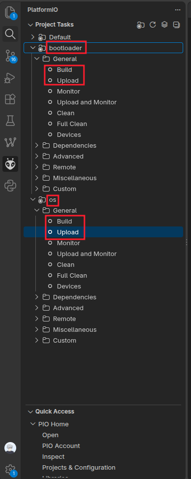

<br>

## 

To test it, you will need to use a Flight Simulator that supports outputting live flight telemetry and sensor data through some sort of medium.

> ## Hardware & Regulatory Notice: 
> The AeroDENS system currently operates exclusively via **USB USART Mode**. While direct integration with the **ARINC 429** avionics data bus is on our roadmap, it is temporarily deferred. Interfacing directly with Airbus communication systems requires specialized transceiver hardware, as well as strict adherence to FAA/EASA regulatory compliance and safety certifications (such as DO-178C) to tap into the aircraft's critical databuses.
> 
>   
>With the project's strict **2 month** development timeline, this feature is currently not feasible for production level implementation.
> 
In this setup, I have used [Infinite Flight Simulator](https://infiniteflight.com/), an Android based Flight Simulator app that supports outputting Telemetry & Sensor Data via its [Connect API](https://infiniteflight.com/guide/developer-reference/connect-api/overview) which transmits data through a Local TCP Websocket. It is a very nice, lightweight and advanced flight simulator system which somewhat levels the same with famous PC based flight simulators such as MSFS (Microsoft Flight Simulator).

As you can see on the short demo below, I am utilizing my `SM-S731B` Samsung S25 FE Device which has the specs and capability to run the flight simulator application. Every telemetry and sensor data updates on the simulator reflects it in realtime in the AeroDENS system, wirelessly.

[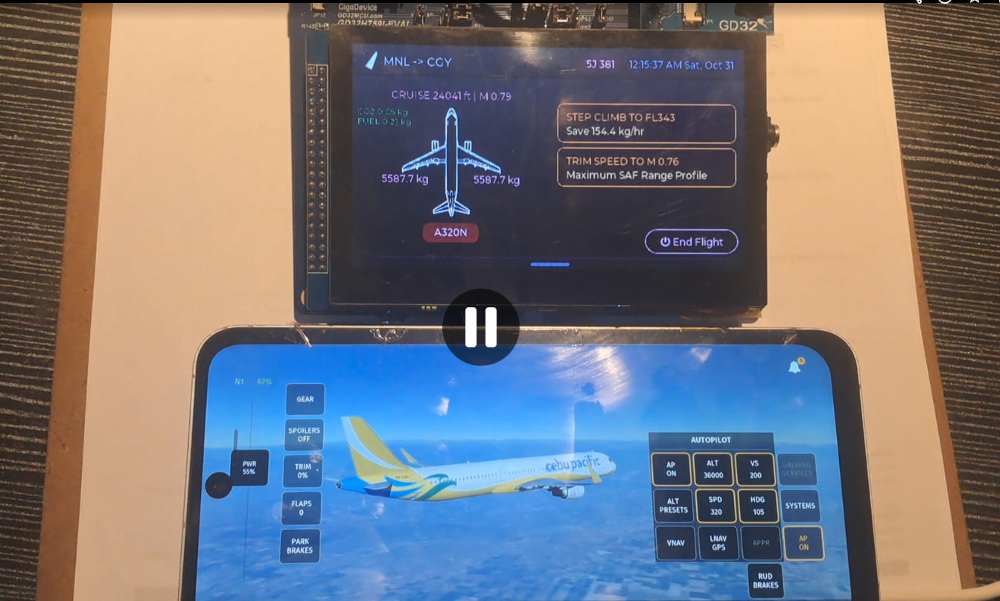](https://res.cloudinary.com/dezykjpfz/video/upload/v1793813286/demo_advisory_feature_rncjo1.mp4)

The way this is possible is that I made a tool which you can run with `python3` on `tools/tester/simulator_binder.py` that automatically connects and negotiates with an active Infinite Flight Simulator flight session.

The diagram below shows how I coded the script to seamlessly communicate sensor data from my phone to AeroDENS' system thru USART USB C connection.

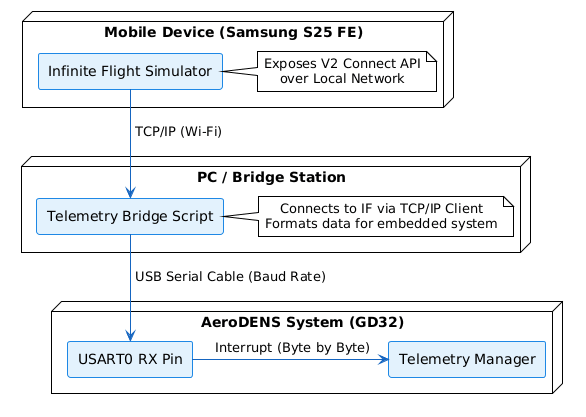

When we run 

``` bash
python3 tools/tester/simulator_binder.py

```

It will try to find the available active devices running Infinite Flight Simulator by scanning UDP port `15000` which Infinite Flight uses to broadcast information regarding active simulator sessions on the local network

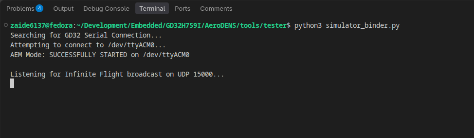

As you can see above, it first scans for connected GD32 devices via Serial. You will have to connect the GD32 development board via its USART port, not the GDLink port, as shown in the image below

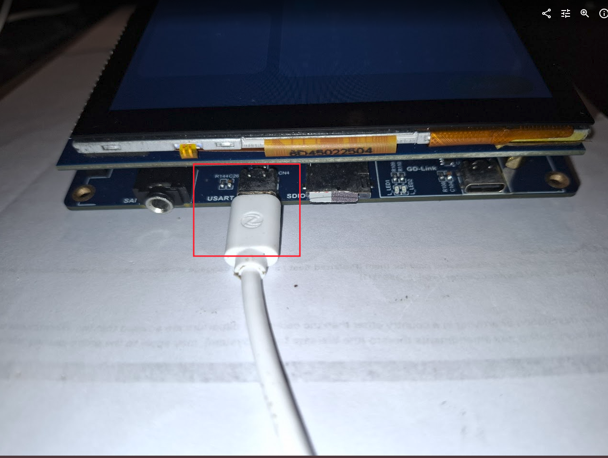

For the `simulator_binder.py` tool to detect the connected GD32 device, you must have an open flight telemetry session. It should show "Waiting" as shown in the image below, while connected to the PC. This will make the tool establish a connection with the PC and GD32 device via USART.

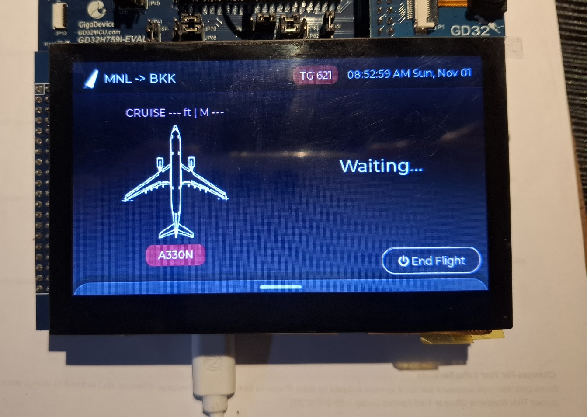

Once it finds an active Infinite Flight Session, it will automatically connect to the Device's assigned local IP address + port and print all values detected in the Connect API to the console for debugging.

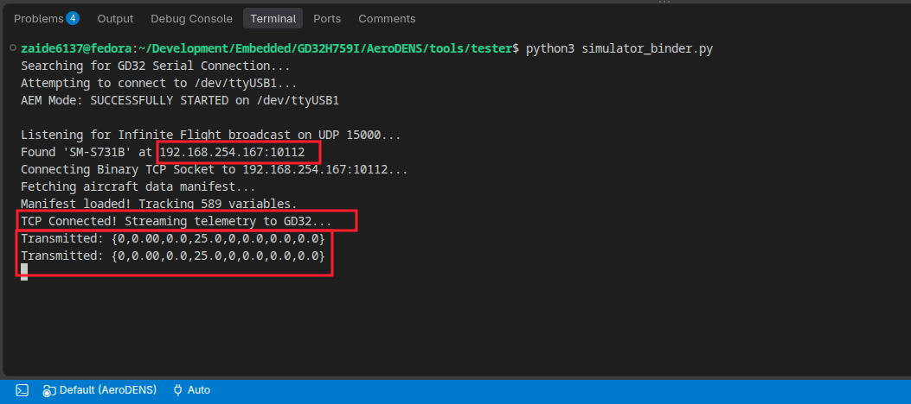

Once connected, it will then start to broadcast live telemetry data, including the Advisories generated by AeroDENS' Calculation Engine. You can then operate your flight normally in the simulator, either load the correct flight plan as indicated on AeroDENS' flight configuration, or just do some free flying for testing.

>Please  note that on the free version of Infinite Flight Simulator which I used, airport destinations and flight plans are limited to US based airports only, while AeroDENS' supported airlines & flight paths are different from the simulator. This is okay for testing, but for long flights, it must match the actual flight duration shown in AeroDENS. 

---

<br>

 

AeroDENS solves a calibration flaw in legacy flight computers caused by volumetric fuel measurement. Aircraft sensors measure fuel by the space it takes up (volume) rather than its actual physical mass. To calculate weight, standard Flight Management Systems (FMS) on aircrafts such as the Airbus, multiply this volume by a hardcoded density of *0.803 kg/L*, assuming a constant outside temperature of *15°C* and standard *Jet A-1 fuel*. However, jet fuel physically expands in warmer temperatures, and modern Sustainable Aviation Fuel (SAF) has a lighter base weight. The AeroDENS Physics Advisory Engine bypasses this flaw by intercepting live telemetry, such as Outside Air Temperature (OAT) and tank volumes from an input bus, either connected via USB USART from a Flight Simulator, or ARINC 429 bus for actual Airbus Aircrafts. 

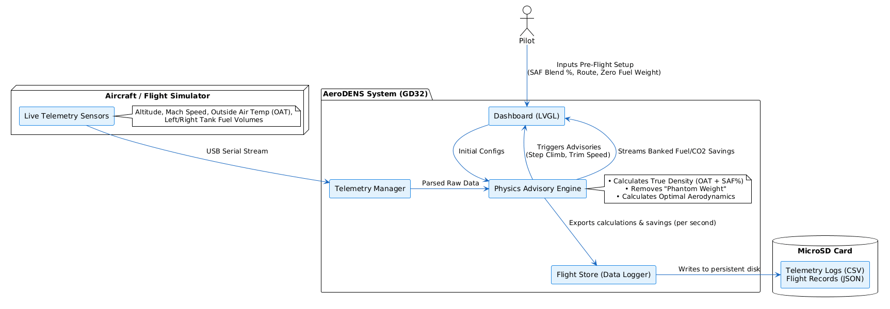

On the diagram above, the system operation begins with two distinct data streams converging into the AeroDENS GD32 system. First, the pilot manually inputs pre flight setups, such as the SAF blend percentage, route, and Zero Fuel Weight, into the LVGL powered Dashboard, which then passes these initial configs directly down to the Physics Advisory Engine. Simultaneously, the aircraft or flight simulator's live telemetry sensors broadcast realtime state data, including Altitude, Mach Speed, Outside Air Temperature (OAT), and Left/Right Tank Fuel Volumes over a USB serial stream. The Telemetry Manager intercepts this stream and feeds the parsed raw data into the Physics Advisory Engine.


The Physics Advisory Engine involves calculating the exact physical mass and optimal aerodynamic profile of the aircraft. It recalculates the true density in real time by establishing a base density based on the fuel blend:

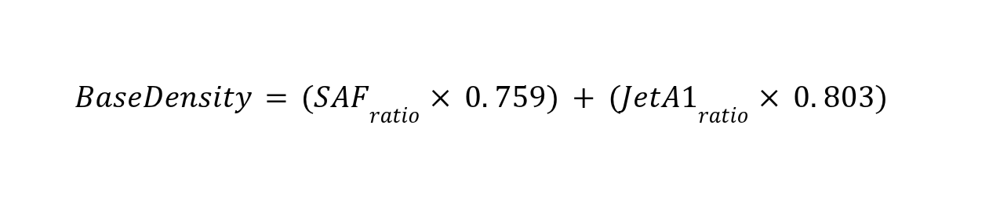

It then dynamically adjusts this value for the live weather, applying a thermal expansion drop of *0.0007 kg/L* for every degree above standard:

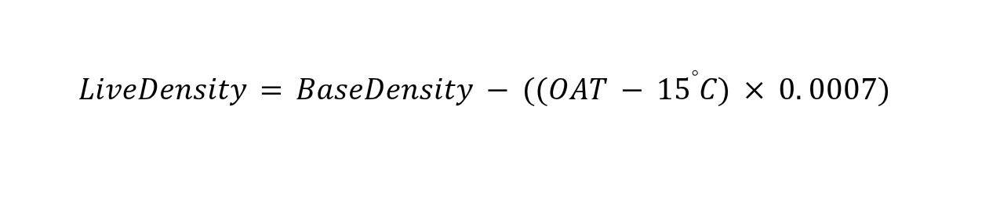

Where OAT Stands for the Outside Air Temperature. These baseline numbers and thermal coefficients are defined by [ASTM D1655](https://store.astm.org/d1655-26b.html) and [ASTM D7566](https://store.astm.org/d7566-22.html) aviation specifications, documented in resources like [Skybrary's Aviation Fuels Technical Review](https://skybrary.aero/bookshelf/aviation-fuels-technical-review) guide.

Once the correct density is established, the system identifies and isolates "Phantom Weight." Because a legacy FMS multiplies hot, expanded fuel volume by a rigid density standard, it artificially adds hundreds of kilograms to the aircraft's calculated weight that do not physically exist. AeroDENS systematically strips this error out. It reverse engineers the raw volume reading using


calculates the true physical mass with


and determines the exact discrepancy:

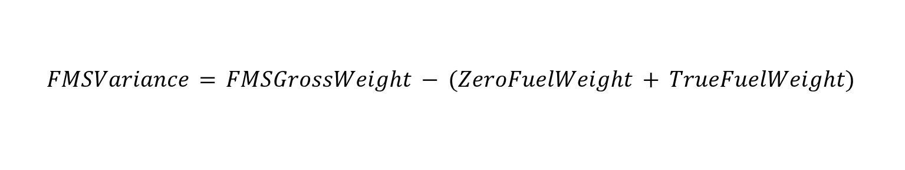

This specific payload and volumetric fueling error is a recognized, industry-wide operational challenge. While extensively detailed in the official [Airbus Safety First Magazine, Issue 19](https://skybrary.aero/sites/default/files/bookshelf/3833.pdf) within their core analysis on Understanding Weight and Balance (page 36), which explicitly notes that "the fuel density used to perform the calculation is not always the actual density [as] it is indeed quite sensitive to temperature", the underlying thermodynamic physics universally affect the Airbus A320 and A330 fleets targeted by AeroDENS.

By shedding this imaginary weight, AeroDENS establishes a highly accurate True Gross Weight, which completely changes the aerodynamic equation. Weight dictates lift, and lift dictates drag. With a mathematically proven lighter aircraft, the system knows the plane is capable of flying at a higher, more efficient cruise altitude where the air is thinner and parasitic drag is lower. The engine calculates the

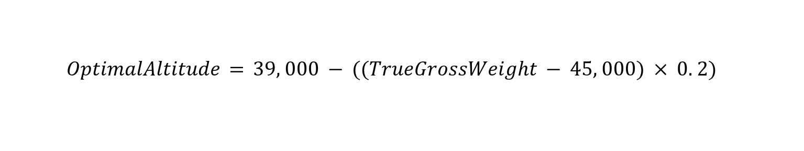

If the plane is flying too low, it suffers an altitude deficit in dense air. The potential savings for climbing are quantified by the regression formula:

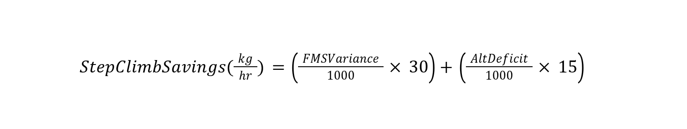

This linear regression is derived directly from Airbus A320 Flight Crew Operating Manual (FCOM) cruise performance tables, aligning with Eurocontrol's BADA (Base of Aircraft Data) models for speed and cost index management, which you can explore via the [Eurocontrol BADA Aircraft Performance Operations](https://www.eurocontrol.int/model/bada).

When AeroDENS identifies these inefficiencies, like flying too low or pushing past Mach 0.77 into heavy wave drag, it triggers actionable advisories on the LVGL powered Dashboard. The moment the pilot complies and corrects the flight profile, the advisories vanish, and the system records the reduced CO2 values. It continuously streams the banked fuel and CO2 savings, proving exactly how much waste was prevented. The math running on the GD32 microcontroller utilizes a double precision accumulator and the system tick to guarantee zero floating point drift:


Since burning 1 kg of Jet A-1 produces exactly 3.16 kg of CO2 exhaust, the total emissions prevented are simply


This 3.16 emission index is the global standard metric used by aviation authorities, as stated on section 2.2.3 of the [IATA Passenger CO2 Calculation Methodology](https://www.iata.org/contentassets/139d686fa8f34c4ba7a41f7ba3e026e7/iata-rp-1726_passenger-co2.pdf) . Ultimately, every calculated drop of fuel and gram of carbon is exported and written to the persistent flight logs stored in the MicroSD, allowing the recorded flight data to be audited outside AeroDENS, and through a computer.

---

<br>

## 

- **Microcontroller**: [GigaDevice GD32H759I](https://www.gd32mcu.com/cn/download?kw=H7&lan=cn) (ARM Cortex-M7 running up to 600 MHz, 3,840 KB internal Flash, 1 MB internal SRAM).

- 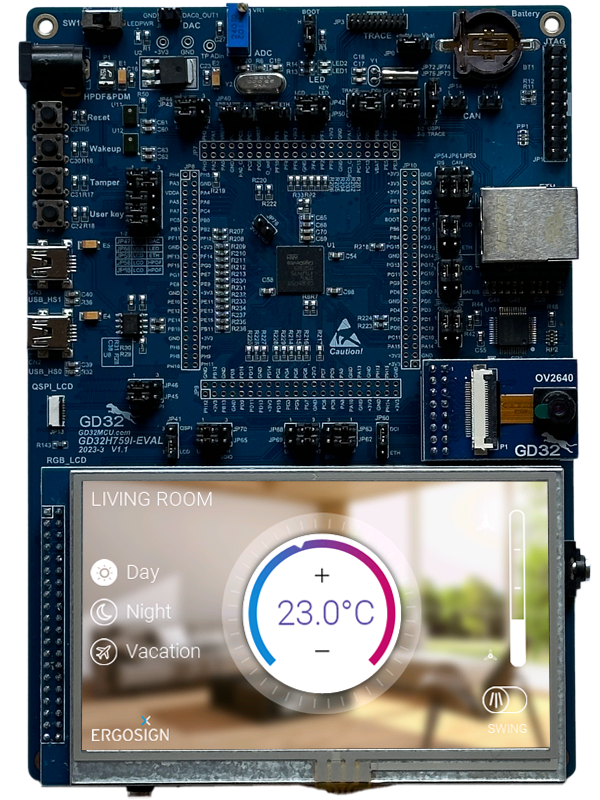
- **Display Subsystem**: 4.3-inch 480x272 RGB LCD driven by the GD32 TFT LCD Interface (TLI) and accelerated via the Image Processing Accelerator (IPA) hardware DMA engine.
- **Touch Input**: Goodix GT911 5 point capacitive touch panel communicating via software I2C.
- **Operating System**: [RT-Thread RTOS](https://www.rt-thread.io/download.html?download=RT-Thread) (preemptive multitasking, mutexes, semaphores, and thread management).  
 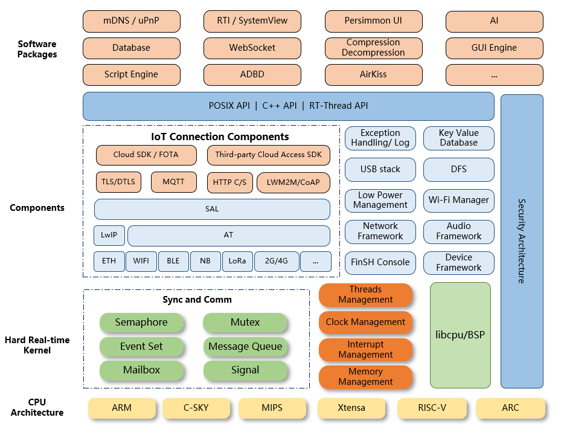

- **Graphics Library**: LVGL v8 (v8.4.0) with double draw buffers in internal RAM and custom theme styling.
 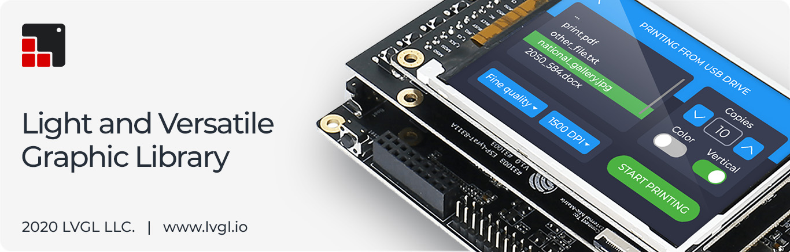

- **File System**: FatFs (R0.15) over high speed SDIO for flight data logging.
- **Build System**: PlatformIO Core with custom python pre- and post-processing build scripts.
 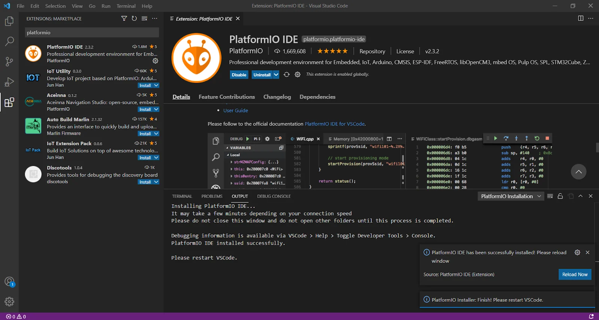

- **Debugger / Flashing**: OpenOCD with CMSIS-DAP / GD-Link interface scripts.
- **Flashing Utility**: Standalone Python utility for easy firmware installation & updates.
 

<br>

## 

```
AeroDENS/
│
├── assets/                  
│   ├── boot_animation/      # 72 animation source frames
│   ├── icons/               # Airline emblems (5J, PR, TG) and aircraft models
│   └── logo/                # Boot and error screen graphics
│
├── build/                   # Auto-generated folder where compiled binaries, tar package, and manifests gets saved.
│
├── docs/                    # Documentation and guides
│   ├── GETTING_STARTED.md   # Setup, flashing, and build instructions
│   └── TROUBLESHOOTING.md   # Detailed hardware and software troubleshooting guide
│
├── include/                 
├── ldscripts/               # GNU LD linker scripts for bootloader and OS
│
├── src/                     
│   ├── bootloader/          # Stage-1 bootloader and decompression engine
│   └── os/                  # RTOS main, telemetry, Physics & Closed-Loop Advisory Engine, and LVGL UI screens
│
├── tools/                   
│   ├── flasher/             # Flasher Utility (Supports GUI Mode, CLI Mode)
│   ├── tester/              # Python3 Script Utility that Binds Infinite Flight Sensor & Telemetry data to USB USART
│   ├── mk_anim_bin.py       # Delta RLE boot animation packer
│   ├── mk_icon_c.py         # LVGL C icon descriptor generator
│   └── mk_logo_bin.py       # Static logo container generator
│
├── build-all                # Auto build from source script
├── flashinfo.txt            # Auto Generated Human readable Flash allocation map
└── platformio.ini           # PlatformIO project configuration
```

---

<br>

## 

If you encounter issues during hardware setup, board flashing, or live telemetry streaming, refer to the [Troubleshooting Guide](docs/TROUBLESHOOTING.md). It provides solutions for common hardware and software issues, including evaluation board jumper configurations (such as JP66 display routing and JP52/JP62/JP65 SDIO signals), OpenOCD debugger and CMSIS-DAP connection permissions, MicroSD card formatting and initialization, Goodix GT911 touch sensor calibration, and simulator binder network discovery.

---

<br>

## 

### Airline Affiliation and Trademarks
AeroDENS is an independent, non commercial engineering and research project developed entirely as a solo initiative. It is CURRENTLY not affiliated with, sponsored by, endorsed by, or partnered with any commercial airline, aircraft manufacturer, or aerospace corporation. 

All airline names, liveries, emblems, logos, callsigns, and trademarks referenced within this repository and user interface,including Cebu Pacific (5J / CEB), Philippine Airlines (PR / PAL), and Thai Airways (TG / THA), remain the exclusive intellectual property of their respective trademark holders. Their appearance in this project is strictly for illustrative UI layout demonstration, realtime route parsing, and avionics display testing.

### Flight and Navigation Data
All flight numbers, airport waypoints, origin/destination pairs, coordinates, and scheduled block times utilized in the configuration files are compiled solely from publicly available flight schedules and open aeronautical sources.

### Operational Certification
AeroDENS is an experimental avionics prototype built solely for flight simulation and embedded systems research on ARM Cortex-M7 hardware. To bypass the extensive implementation time and rigorous safety certifications required to interface directly with a commercial aircraft's ARINC 429 data bus, the system currently utilizes a USB USART connection for all flight sensor and telemetry data ingestion. Because it lacks DO-178C and DO-254 compliance, the system is not yet certified by the FAA, EASA, CAAP, or any other civil aviation authority. It is strictly not intended for operational navigation, fuel dispatch planning, or flight crew decision-making in realworld aircraft.

---

<br>

## 

### License
AeroDENS is released under the MIT License. You are free to inspect, modify, adapt, and distribute this software for personal, academic, and research purposes, provided that the original copyright notice and permission notice remain intact.

### Contributing
Contributions, feature suggestions, and bug reports are welcome:

1. **Reporting Issues**: If you encounter bugs or hardware incompatibilities, open an issue on the repository issue tracker with your board revision, firmware version, and terminal logs.
2. **Feature Additions**: Proposals for new aerodynamic models (e.g. additional BADA aircraft performance profiles), driver enhancements, or UI improvements can be submitted via Pull Requests.
3. **Pull Request Guidelines**:
   - Ensure your code compiles cleanly using `./build-all`.
   - Verify that your additions respect the internal Flash and SRAM partition limits.
   - Maintain clean, descriptive commit messages without extraneous build artifacts.

### Acknowledgments
This project is made possible thanks to the following open-source frameworks and technologies:
- [PlatformIO](https://platformio.org/) - Microcontroller compilation and dependency management.
- [PlatformIO GD32H759 Support Packages](https://github.com/jian6137/platform-gd32h7) - A platformio support package developed by me allowing GD32H759 development boards to have PlatformIO support.
- [LVGL](https://lvgl.io/) - Light and Versatile Graphics Library for embedded displays.
- [LVGL Port for GD32H759](https://github.com/GigaDevice-GD32-MCU/GD32H759_EVAL_LVGL) - An LVGL port for the GD32H759 board to fix issues such as random freezing
- [RT-Thread](https://www.rt-thread.io/) - Real-time operating system kernel and synchronization primitives.
- [ChaN FatFs](http://elm-chan.org/fsw/ff/00index_e.html) - MicroSD file system module for persistent flight telemetry logging.
- [GigaDevice](https://www.gd32mcu.com/) - High-performance GD32H759 ARM Cortex-M7 microcontroller platform.

